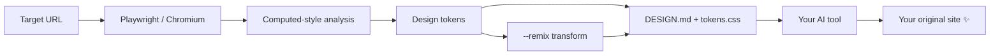

<div align="center">

# 🧬 design-dna

### Read the *design language* of any website. Let your AI build something original with the same vibe.

**Colors · Typography · Spacing · Radius · Shadows · Layout rhythm · Breakpoints · Screenshots**
→ one AI-ready `DESIGN.md` + `tokens.css`

[](#)
[](#)
[](#)
[](LICENSE)
[](#-contributing)

</div>

---

## ✨ Why design-dna?

You found a website whose look and feel is *exactly* what you want. Now you want your AI coding tool to build **your** product with that same polish, without pasting 40 screenshots and hoping for the best.

`design-dna` opens the page in a real browser, measures how it is actually styled, and writes a compact brief that any AI tool can follow.

| 😩 Without design-dna | 😎 With design-dna |
| --- | --- |
| "Make it look like Stripe" → vague guesses | Exact colors, type scale, spacing, radius, shadows |
| AI invents random layouts | Section-by-section structure with grid/flex info |
| Hours of eyeballing DevTools | One command, 10 seconds |
| Accidentally copying someone's work | Built-in **remix mode** + originality rules for the AI |

## 🚀 Quick start

```bash
git clone https://github.com/<your-username>/design-dna.git
cd design-dna
npm install            # also downloads Chromium via Playwright

node bin/cli.js https://example.com --remix
```

Output lands in `output/example.com/`:

```
output/example.com/
├── DESIGN.md          ← the AI-ready design brief
├── tokens.css         ← CSS variables (remixed with --remix)
├── design-dna.json    ← raw measurements
└── screenshots/       ← desktop fold, full page, mobile (visual reference)
```

## 🤖 Use it with your AI tool

1. Clone this repo (or open it in your AI editor).
2. Run the extractor on any site you like.
3. Tell your AI:

> *Read `output/example.com/DESIGN.md` and `tokens.css`, then follow `prompts/build-site.md` to build my project: **[describe your site]**.*

The repo ships an [`AGENTS.md`](AGENTS.md) so agentic tools (Codex, Claude Code, Cursor agents, etc.) know the workflow automatically. Just say: *"Use design-dna on https://… and build me a landing page for my app."*

## 🎛 Options

| Flag | What it does |
| --- | --- |
| `--remix` | Shifts the palette hue, swaps known proprietary fonts for similar open-source ones, and nudges the radius, so your build is clearly its **own** design |
| `--seed <n>` | Makes `--remix` repeatable |
| `--out <dir>` | Custom output folder |
| `--no-mobile` | Skip the mobile screenshot |

## 🔍 What gets extracted

- 🎨 **Color**: text, background, border, gradients, inferred accent
- 🔤 **Typography**: families, h1–h4 / body / button styles, size & weight scale
- 📏 **Spacing & shape**: spacing values in use, radius, shadows, container widths
- 🔘 **Buttons**: background, radius, padding, border, weight
- 🧱 **Layout**: ordered page blocks with height, background, grid/flex columns, content counts
- 📱 **Breakpoints** and dark-mode detection
- 🧩 Source **CSS variables** (`:root`)
- 📸 Screenshots for vision-capable AI tools

See a sample: [`examples/sample-DESIGN.md`](examples/sample-DESIGN.md).

## 🧠 How it works



## ⚖️ Responsible use (please read)

Design *style* (colors, spacing, general layout patterns) is generally treated differently from protected *expression* (text, logos, illustrations, photos, code, distinctive brand identity). `design-dna` is built around that line:

- It records **style measurements and structure only**. It does **not** save page text, images, logos, icons, fonts, or source code.
- Generated briefs tell the AI to write **original copy, branding, and components**.
- `--remix` pushes your result further from the source.

What this tool **cannot** do is make a near-identical copy of someone else's site legally safe. Making a site that is "slightly different" does not protect you if it copies protected content or trade dress, or impersonates a brand. Use it to learn from great design, not to clone or deceive. Only analyze pages you're allowed to access, respect `robots.txt` and each site's terms, and get legal advice for commercial work.

## 🗺 Roadmap

- [ ] Multi-page crawl (home, pricing, blog) with shared token merge
- [ ] Export Tailwind config & Figma tokens
- [ ] Motion/animation extraction (durations, easings)
- [ ] Dark-mode token capture
- [ ] Compare two sites and produce a blended brief
- [ ] Contrast (WCAG) report

## 🤝 Contributing

PRs and ideas are very welcome. Fork → branch → PR. Good first issues: more font-alternative mappings in `src/report.js`, new extraction signals in `src/extract.js`.

## 📄 License

[MIT](LICENSE). Build something beautiful (and original). ⭐ Star the repo if it helped you!
